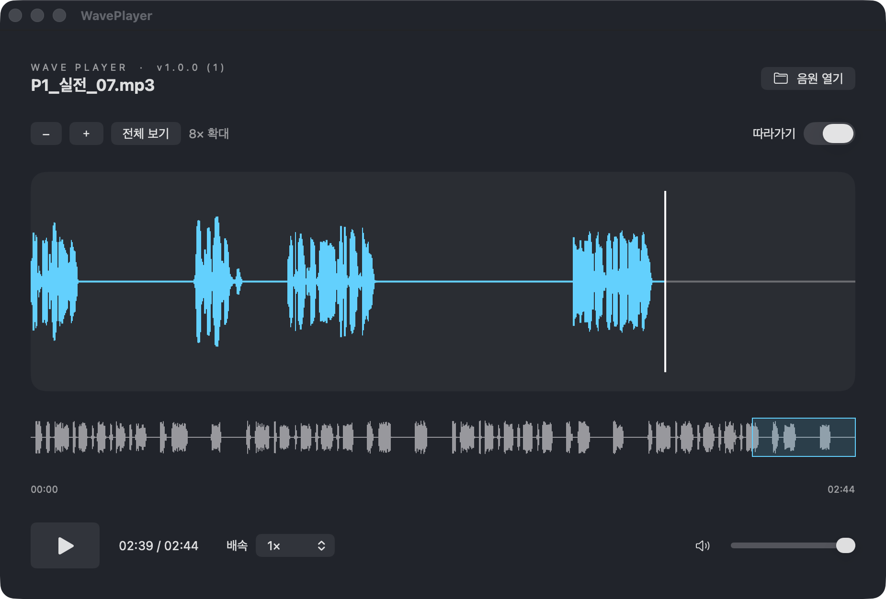

# WavePlayer

macOS용 음원 파형 플레이어입니다. 음원의 파형을 확대하며 재생 위치를 찾고, 느린 배속으로 구간을 확인할 수 있습니다.

## 앱 미리보기



음원을 불러온 실제 앱 화면입니다. 확대된 파형과 전체 미니맵으로 재생 위치를 확인할 수 있습니다.

## 요구 사항

- 실행: macOS 14 이상, Apple Silicon 또는 Intel Mac
- 개발: Swift 6 이상 및 macOS SDK (Xcode 또는 Command Line Tools)
- 외부 패키지 의존성 없음: SwiftUI와 AVFoundation 사용

## 설치

[GitHub Releases](https://github.com/skykhs3/wave-player/releases)에서 `WavePlayer-1.0.1-build2-macOS.zip`을 다운로드하세요. 압축을 풀고 `WavePlayer.app`을 응용 프로그램 폴더로 옮겨 실행합니다.

배포본은 로컬 임시 서명(ad hoc)을 사용하며 Apple 공증을 받지 않았습니다. 다른 Mac에서는 보안 경고 또는 실행 차단이 발생할 수 있습니다. 출처를 확인한 경우 시스템 설정 → 개인정보 보호 및 보안에서 실행 허용을 확인하세요. 조직 보안 정책에 따라 허용이 불가능할 수 있습니다. 경고 없는 일반 배포에는 Developer ID Application 서명 및 Apple 공증이 필요합니다.

## 사용법

| 조작 | 기능 |
| --- | --- |
| ⌘O 또는 파일 드래그 앤 드롭 | 음원 열기 |
| ← / → | 5초 전 / 후 이동 |
| F | 따라가기 켜기 / 끄기 |
| 스페이스 | 재생 / 일시정지 |
| 파형 좌클릭 / 드래그 | 재생 위치 이동 |
| 파형 우클릭 드래그 | 확대된 파형 화면 이동 |
| ＋ / − / 전체 보기 | 파형 확대 / 축소 / 초기화 |
| 미니맵 클릭 / 드래그 | 표시 구간 이동 |
| 따라가기 | 재생 위치에 맞춰 파형 화면 이동 |
| 배속 선택 | 0.25×, 0.5×, 0.75×, 1× |

## 개발 및 빌드

```sh
swift build
swift run WavePlayer
```

Apple Silicon과 Intel을 모두 지원하는 앱 번들과 ZIP을 생성하려면:

```sh
./scripts/package.sh
```

결과는 `dist/`에 생성됩니다. 빌드 결과물은 Git에 포함하지 않고 GitHub Releases로 배포합니다.

- `VERSION`: 표시 버전 (현재 1.0.1)
- `BUILD_NUMBER`: 내부 빌드 번호 (현재 2). 배포를 갱신할 때 증가시키세요.
- `Assets/Icon.png`: 앱 아이콘 원본

아이콘을 다시 생성하려면:

```sh
swift scripts/icon.swift Assets/Icon.png
```

## 프로젝트 구조

```text
Sources/WavePlayer/   앱과 파형·재생 UI
Assets/              앱 메타데이터와 아이콘
scripts/             아이콘 생성 및 배포 패키징
Package.swift        Swift 패키지 정의
VERSION              표시 버전
BUILD_NUMBER         내부 빌드 번호
```
